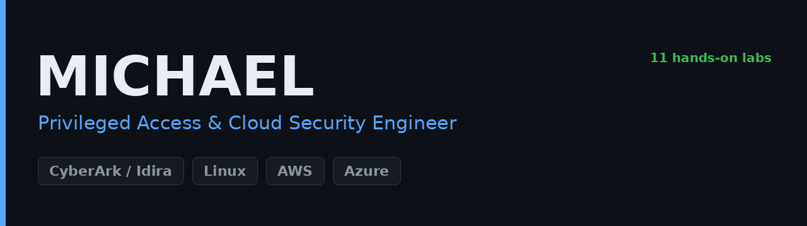

  

### Hi, I'm Michael

[][linkedin]
[][wgu]

I am an **identity and privileged access engineer**. I build IAM and PAM systems for cloud environments and test them in real labs. I write down what failed and how I fixed it.

## Current work

- **Hospital identity platform:** IAM/PAM for a fictional 5,000-person hospital, running in a real Microsoft Entra tenant. Joiner-mover-leaver automation, Conditional Access, PIM, PAM and detections, all as code.
- **PAM x Cloud Labs:** 11 labs across CyberArk/Idira, Linux, AWS and Azure. Secrets injection, shadow admin audits, least-privilege IAM and detections.

_These repos are private. Code is available on request. My coursework is [here][wgu]._

## Focus

Identity and access management · Privileged access · Cloud security · Detection engineering · Automation · AI/ML

## Certifications

CyberArk Guardian, Sentry, Defender · Red Hat RHCSA, RHCE · Microsoft SC-300 · Salesforce Platform Administrator · CompTIA Security+, Network+ · Google Cybersecurity

## Education

B.S. and M.S. in Computer Science, Western Governors University

## Tools

Entra ID · CyberArk · AWS · Azure · Terraform · Ansible · Kubernetes · Sentinel · Splunk · PowerShell · Python · Linux

<!-- LINKS -->
[wgu]: https://github.com/Bachelor-and-Masters-Class
[linkedin]: https://linkedin.com/in/michael-williams-21938325a
